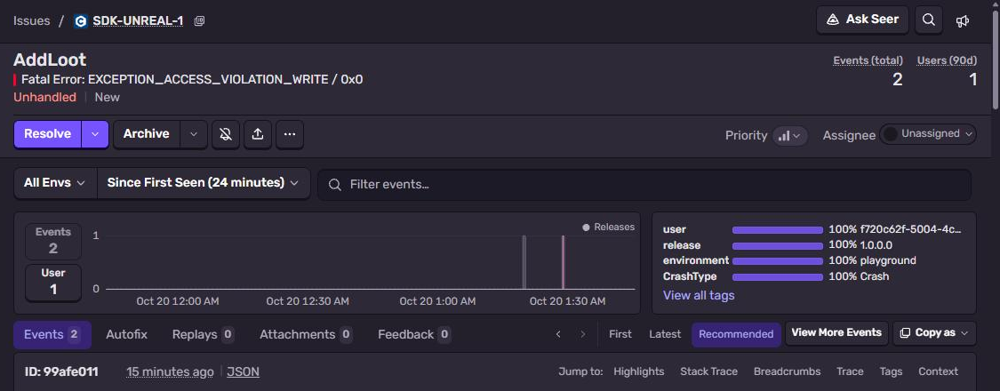
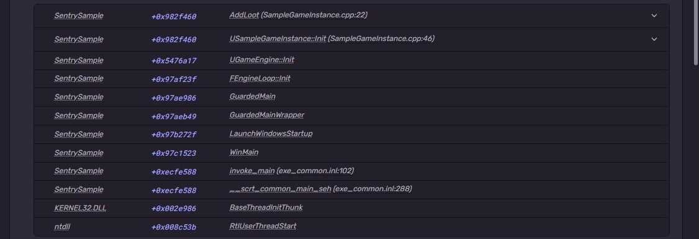
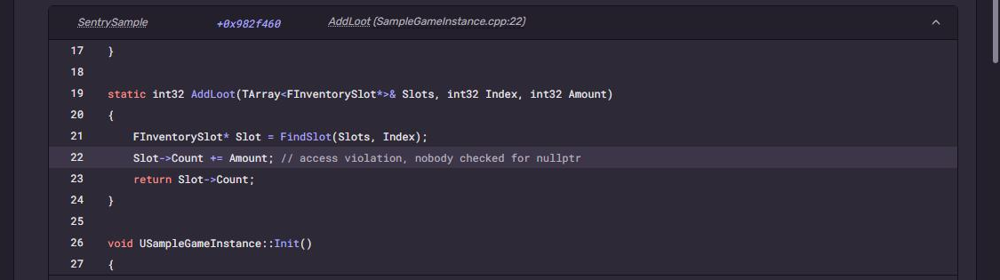

# Sentry + Unreal Engine 5

Smallest UE5 C++ project with the Sentry plugin. The packaged game dereferences a `nullptr`, crashpad
catches it and sends a minidump, Sentry symbolicates it with the PDBs uploaded during packaging.
No editor work needed, everything is command line.
Part of [Sentry Playground](https://github.com/fsmaster/sentry-playground). The playground button runs
the workflow of this repo, which downloads the packaged game and crashes it on a Windows runner.



## What you need

- Windows 10/11, about 60 GB free disk
- **Unreal Engine 5.8** from the Epic Games Launcher (Library → Engine Versions → +). It can be installed on
  any drive, this guide uses `D:\Program Files\Epic Games\UE_5.8`
- **Visual Studio 2026 Build Tools** (or VS 2026) with "Desktop development with C++" and the
  **.NET Framework 4.8 SDK**. See "Toolchain" below, this was the main pain
- Sentry project with platform **Unreal Engine**, and an auth token (**Settings → Auth Tokens**)

## 1. Get the project and the plugin

```powershell
git clone https://github.com/fsmaster/sentry-sample-unreal.git
cd sentry-sample-unreal
gh release download 1.25.0 -R getsentry/sentry-unreal -p "sentry-unreal-1.25.0-engine5.8.zip"
Expand-Archive sentry-unreal-1.25.0-engine5.8.zip -DestinationPath Plugins\Sentry
```

No `gh`? Download the same zip from [sentry-unreal releases](https://github.com/getsentry/sentry-unreal/releases)
and unzip into `Plugins\Sentry`. Take the zip for your engine version. The plugin is not in this repo,
it's ~250 MB.

## 2. Configure

`Config/DefaultEngine.ini`, put your DSN:

```ini
[/Script/Sentry.SentrySettings]
InitAutomatically=True
Dsn="https://<key>@<org>.ingest.us.sentry.io/<project-id>"
EnableAutoCrashCapturing=True
UploadSymbolsAutomatically=True
IncludeSources=True
```

The symbol upload reads org, project and token from env vars (or from a `sentry.properties` file in
the project root, don't commit that one):

```powershell
$env:SENTRY_ORG = "<your-org>"
$env:SENTRY_PROJECT = "<your-project>"
$env:SENTRY_AUTH_TOKEN = "sntrys_..."
```

## 3. Package

```powershell
& "D:\Program Files\Epic Games\UE_5.8\Engine\Build\BatchFiles\RunUAT.bat" BuildCookRun `
  -project="$PWD\SentrySample.uproject" -platform=Win64 -clientconfig=Development `
  -build -cook -stage -pak -archive -archivedirectory="$PWD\Packaged" -nop4 -unattended
```

First time it compiles the plugin and cooks engine content, takes 10-20 minutes. Near the end of the
log:

```
Sentry: Start debug symbols upload
> Found 6 debug information files
> Resolved source code for 1 debug information file
  UPLOADED fe185d48-... (SentrySample.pdb; x86_64 debug companion)
  UPLOADED fe185d48-... (SentrySample.pdb; x86_64 sources)
BUILD SUCCESSFUL
```

## 4. Crash it

```powershell
.\Packaged\Windows\SentrySample.exe -sentryrun=test-1 -nullrhi -unattended -nosplash -log
```

`-nullrhi` runs without GPU (that's how CI does it), you can drop it on a normal PC. The process exits
with `-1073741819` = `0xC0000005` access violation. `crashpad_handler.exe` lives a bit longer and
uploads the minidump.

## 5. Check it in Sentry

Issue title is `AddLoot`, the function that crashed, `Fatal Error: EXCEPTION_ACCESS_VIOLATION_WRITE / 0x0`
(write to address 0). Frames: `AddLoot` (SampleGameInstance.cpp:22) ← `USampleGameInstance::Init` (:46) ←
`UGameEngine::Init` ← ... ← `WinMain`, all with real names from the PDB:



Expand the top frame and there is the C++ code, from `IncludeSources=True`:



`run_id` tag is there too. It was set before the crash and crashpad wrote it into the minidump.

## How it works

`Source/SentrySample/SampleGameInstance.cpp`:

```cpp
USentrySubsystem* Sentry = GEngine->GetEngineSubsystem<USentrySubsystem>();
Sentry->SetTag(TEXT("run_id"), Run);

TArray<FInventorySlot*> Slots;
Slots.Init(nullptr, 4);
AddLoot(Slots, 3, 10);   // Slot->Count += Amount on a nullptr
```

- Sentry starts by itself (`InitAutomatically=True`), before the game instance.
- On Windows the plugin uses sentry-native with **crashpad**. Crash handling is out of process, so it
  works even when the game memory is broken.
- The PDB is **not** shipped. It's in Sentry, matched to the exe by debug id. Every packaging produces
  new ids, so ship and upload from the same packaging run.
- Crashes are grouped by stack trace. Unlike other samples in the playground, each click is a new
  event in the same issue, not a new issue.

## Toolchain (things that broke)

1. **`UnrealBuildTool has banned the MSVC 14.40.0-14.43.99999 toolchains`.** UE 5.8 refuses VS 2022 17.10-17.13
   compilers. Install VS 2026 Build Tools (MSVC 14.50+):
   ```powershell
   winget install --id Microsoft.VisualStudio.BuildTools -e --override "--quiet --wait --add Microsoft.VisualStudio.Workload.VCTools --add Microsoft.VisualStudio.Component.Windows11SDK.26100 --includeRecommended"
   ```
   It warns that 14.51 is "newer than preferred 14.50", it builds fine.
2. **`Could not find NetFxSDK install dir`.** UBT needs .NET Framework SDK for `SwarmInterface`, even for a
   game target:
   ```powershell
   winget install --id Microsoft.DotNet.Framework.DeveloperPack_4 -e
   ```

## CI

GitHub runners don't have UE (and it's 60 GB), so packaging is done on a dev machine and the zip (without
PDBs) is attached to the [`build` release](https://github.com/fsmaster/sentry-sample-unreal/releases/tag/build).
`.github/workflows/trigger.yml` on `windows-latest` downloads it, runs `SentrySample.exe -sentryrun=<id> -nullrhi`
and waits for crashpad to upload.

## Troubleshooting

| Symptom | Why |
|---|---|
| Crash, no event | `crashpad_handler.exe` missing next to plugin binaries in the package, or DSN empty in the packaged config. Run with `-log` and look for `LogSentrySdk`. |
| Frames show only `SentrySample.exe +0x...` | PDB for this exact build not uploaded. Look for `Sentry: Start debug symbols upload` in the packaging log; it is skipped for Editor targets and without org/project/token. |
| `Automatic symbols upload is not required for Editor target` | Normal, it uploads for the Game target later in the same run. |
